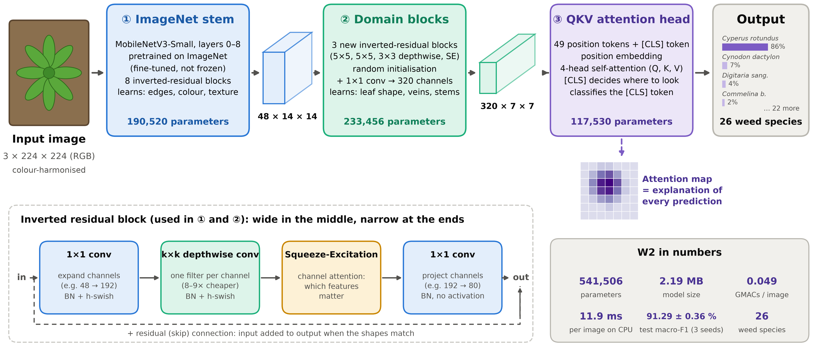
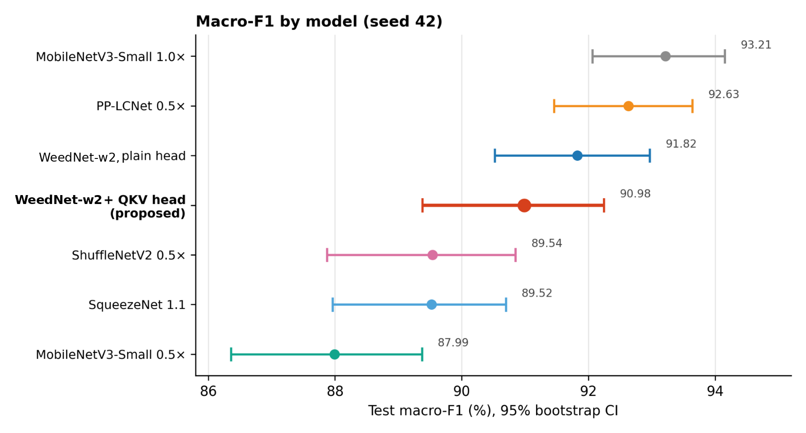
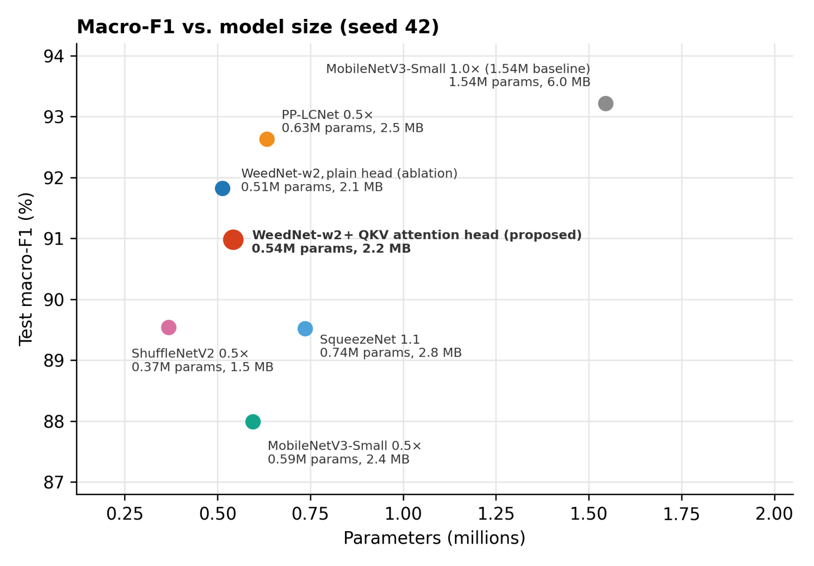
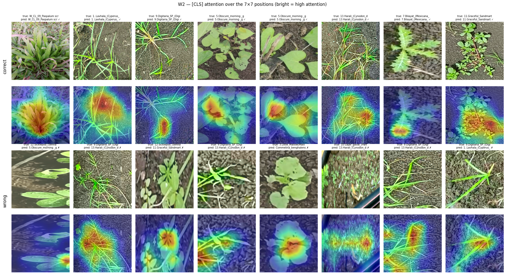
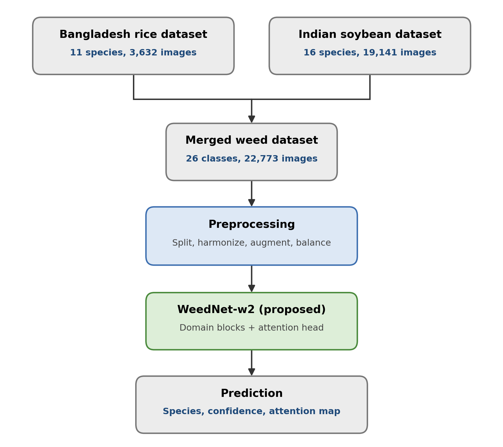

# WeedNet-w2: A Compact Attention-Equipped CNN for Weed Species Classification in Rice and Soybean Fields

**0.54M parameters · 91.3% macro-F1 · 26 weed species · 2 crops · 2 countries · built-in attention maps**

WeedNet-w2 (W2) is a lightweight image classifier for weed species, designed for low-cost, low-power hardware in the field. It keeps the first 9 ImageNet-pretrained layers of MobileNetV3-Small, adds three newly trained MobileNetV3-style blocks, and classifies with a small multi-head self-attention (QKV) head over a `[CLS]` token. The attention head also gives a 7×7 map of where the model looked, for every prediction.

> B.Sc. thesis, Department of Computer Science and Engineering, Metropolitan University, Sylhet, Bangladesh (2026).
> Authors: Mohammad Mostafizur Rahman, Sabbir Ahmed Talukdar, Mushrefa Chowdhury Nubah · Supervisor: Abdul Wadud Sakib.
> Paper: *arXiv link coming soon*



## Highlights

| | |
|---|---|
| **Size** | 541,506 parameters, 2.19 MB weights, 0.049 GMACs per 224×224 image |
| **Accuracy** | 91.29 ± 0.36% test macro-F1, 90.81 ± 0.37% accuracy (3 seeds) |
| **Rare classes** | 91.98 ± 0.69% recall on the 20 rare classes; 94.21 ± 0.51% on the 9 tail classes |
| **Data** | 26 classes, 22,773 images: rice weeds from Bangladesh + soybean weeds from India |
| **vs. baselines** | Significantly better than MobileNetV3-Small 0.5x, ShuffleNetV2 0.5x and SqueezeNet 1.1; on par with PP-LCNet 0.5x; 1.65 F1 points below MobileNetV3-Small 1.0x, which is 2.85× larger |
| **Explainability** | `[CLS]` attention map for every image, at about 5% of CPU time |

## Results

Test set: 3,221 images, 26 classes, seed 42. Significance is from Holm-corrected exact McNemar tests against W2.

| Model | Params (M) | GMACs | CPU ms | Macro-F1 (%) | 95% CI | vs. W2 |
|---|---:|---:|---:|---:|---|---|
| MobileNetV3-Small 1.0x | 1.545 | 0.056 | 12.0 | 93.21 | 92.06–94.15 | better (p < 0.001) |
| PP-LCNet 0.5x | 0.633 | 0.043 | 9.4 | 92.63 | 91.46–93.64 | n.s. (p = 0.20) |
| W2 without attention (W1 ablation) | 0.513 | 0.044 | 11.1 | 91.82 | 90.52–92.97 | n.s. (p = 0.40) |
| **WeedNet-w2 (W2, proposed)** | **0.542** | **0.049** | **11.9** | **90.99** | **89.38–92.24** | – |
| ShuffleNetV2 0.5x | 0.368 | 0.039 | 13.9 | 89.54 | 87.87–90.85 | worse (p = 0.008) |
| SqueezeNet 1.1 | 0.736 | 0.265 | 14.9 | 89.52 | 87.96–90.70 | worse (p < 0.001) |
| MobileNetV3-Small 0.5x | 0.595 | 0.023 | 10.1 | 87.99 | 86.36–89.37 | worse (p < 0.001) |

Seed 42 was W2's weakest of three runs (90.99 / 91.20 / 91.68). Mean over three seeds: W2 91.29 ± 0.36, plain-head ablation 91.22 ± 1.05, MobileNetV3-Small 1.0x 92.94 ± 0.30, MobileNetV3-Small 0.5x 88.25 ± 0.64. CPU latency is the median of 50 runs on a Kaggle CPU (batch 1, 4 threads). Full tables are in [`results/`](results/).

<p align="center"> </p>

**What the attention head does and does not do.** On average it does not improve accuracy over a plain pooled head (91.29 vs 91.22). It made results steadier across seeds (SD 0.36 vs 1.05, from only three seeds) and it gives an explanation map for every prediction:



## Repository structure

```
weednet/
  model.py         WeedNetW2 model (W2 and the W1 ablation), parameter / MAC counters
  transforms.py    Reinhard LAB colour harmonisation + train / eval transforms
  classes.py       the 26 classes in training index order
predict.py         classify one image and save its attention map
notebooks/
  weednet-final.ipynb   full pipeline: data, all 7 models, 3 seeds, statistics, attention maps, latency
results/           result tables as CSV
figures/           figures from the thesis
```

## Quick start

```bash
git clone https://github.com/mustafizz007/weednet-w2.git
cd weednet-w2
pip install -r requirements.txt

python -m weednet.model      # prints 541,506 params, 0.049 GMACs
```

```python
import torch
from weednet import WeedNetW2, get_eval_transform, SPECIES

model = WeedNetW2(num_classes=26)          # ImageNet-pretrained stem, ready to train
logits = model(torch.randn(1, 3, 224, 224))
attn = model.attention_map()               # (1, 7, 7) [CLS] attention from the last forward pass
```

**Inference with trained weights**

```bash
python predict.py --weights weights/weednet_w2_seed42.pt --image leaf.jpg --save-map attention.png
```

Download `weednet_w2_seed42.zip` from [Releases](../../releases) and unzip it into `weights/`, which gives `weights/weednet_w2_seed42.pt` (2.2 MB).

| File | Model | Test macro-F1 | SHA-256 |
|---|---|---:|---|
| `weednet_w2_seed42.pt` | WeedNet-w2, seed 42 (the model reported in the tables above) | 90.99% | `a1a2162087f82567961c9ebcf43e186deccd90386c012e775ae24a48595f8a48` |

The file is a plain PyTorch `state_dict` and loads with `model.load_state_dict(torch.load(path, map_location="cpu"))`.

## Data

The two datasets are public. Download them from their original sources:

| Dataset | Crop / country | Classes | Images | Source |
|---|---|---:|---:|---|
| Rice Field Weed BD v4 | Rice, Bangladesh | 11 | 3,632 | [doi:10.17632/mt72bmxz73.4](https://doi.org/10.17632/mt72bmxz73.4) |
| MH-Weed16, *Individual Weed Species* folder | Soybean, India | 16 | 19,141 | [doi:10.17632/d3n3mgjjbv.1](https://doi.org/10.17632/d3n3mgjjbv.1) |

*Commelina benghalensis* appears in both datasets and is merged, which gives 26 classes. 1,309 white-background studio images are removed from the rice dataset. The remaining 21,464 images are split 70/15/15 with seed 42 (15,024 / 3,219 / 3,221).



## Training setup

| Setting | Value |
|---|---|
| Optimiser | Adam, LR 3×10⁻⁴ for all layers, weight decay 10⁻⁴ |
| Schedule | ReduceLROnPlateau (factor 0.5, patience 2) |
| Epochs | up to 50, early stopping (patience 10), best validation accuracy kept |
| Batch size | 32 |
| Imbalance | weighted random sampler, p ∝ (class size)^−0.5 |
| Preprocessing | Reinhard LAB harmonisation, 224×224, ImageNet normalisation |
| Augmentation | random resized crop (0.6–1.0), flips, affine (±30°), colour jitter, Gaussian blur |
| Seeds | 42, 43, 44 (data split fixed at 42) |
| Hardware | Kaggle, NVIDIA Tesla T4, about 2.5 h per run |

To reproduce everything, run `notebooks/weednet-final.ipynb` on Kaggle (GPU T4, internet on). Training all models from scratch takes about 38 GPU-hours. The notebook is resumable and stops cleanly before Kaggle's 12-hour limit. Instructions are in its first cell.

**Beyond the thesis.** The notebook also contains analyses that are not reported in the thesis: a single-source test, attention-faithfulness tests (deletion/insertion), temperature calibration, and an experimental advisory layer that answers at species, weed-group or "not sure" level. Treat these as exploratory.

## Limitations

- **Small, but not faster.** W2 runs at 11.9 ms on CPU, about the same as MobileNetV3-Small 1.0x (12.0 ms) and slower than PP-LCNet 0.5x (9.4 ms). About 74% of the CPU time is in the ImageNet stem.
- **Limited data variety.** Two sources only. One class has 65 training images, and the five weakest classes all come from MH-Weed16.
- **Latency measured on a Kaggle CPU only.** It has not been tested on real edge devices (e.g. Raspberry Pi).
- **Single runs for some baselines.** ShuffleNetV2, PP-LCNet and SqueezeNet were trained once, and every model used the same shared training recipe without per-model tuning.

## Citation

```bibtex
@thesis{rahman2026weednetw2,
  title  = {WeedNet-w2: A Compact Attention-Equipped CNN for Weed Species Classification in Rice and Soybean Fields},
  author = {Rahman, Mohammad Mostafizur and Talukdar, Sabbir Ahmed and Nubah, Mushrefa Chowdhury},
  school = {Department of Computer Science and Engineering, Metropolitan University},
  address = {Sylhet, Bangladesh},
  type   = {B.Sc. thesis},
  year   = {2026}
}
```

Please also cite the two datasets above if you use them.

## License

Code: [MIT](LICENSE). The datasets keep their original licenses; see their Mendeley Data pages. Figures that show dataset images are reproduced from those datasets.

## Acknowledgements

We thank our supervisor, Abdul Wadud Sakib (Lecturer, Department of CSE, Metropolitan University), for his guidance throughout this work, and the Department of CSE, Metropolitan University, for its support. We also thank the creators of Rice Field Weed BD and MH-Weed16 for making their data public.
